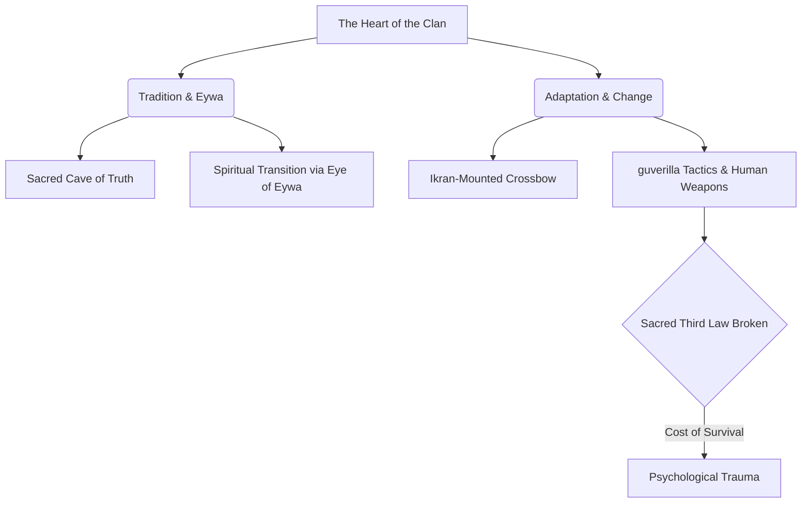

**Prepared for Millie Caicedo**

---

## 1. Introduction & The Grand Premise

*Avatar: Into the Mists* (AITM) is a remarkable, deeply ambitious creative writing project that operates on a scale rarely seen in crossover fiction. It succeeds in a task that on paper sounds nearly impossible: taking the core casts of **Mobile Suit Gundam: The Witch from Mercury**, **Chainsaw Man**, **Bocchi the Rock!**, **BanG Dream! It's MyGO!!!!! & Ave Mujica**, **Jujutsu Kaisen**, **Soul Eater**, and **Alien Stage**, and translating them gracefully into the biology, culture, and spiritual framework of James Cameron's Pandora.

Rather than a simple "characters dropped into a new setting" story, AITM is a **reimagining**. It adapts the central conflicts, emotional dynamics, and thematic weights of each source material, reshaping them into the mythology of the **Astikasya Clan**—a mist-shrouded mountain tribe in Pandora’s Western Frontier. 

The clan's guiding tenets define the entire narrative landscape:
*   **"Adaptation is not betrayal, but reverence in motion."**
*   **"A gentle kingdom ringed in spears."**

These philosophies set up a constant, beautiful tension: How much can a culture change, innovate, and weaponize to protect itself from the devastating threat of the RDA before it loses its soul?

---

## 2. Crossover Integration & Family Breakdowns

The genius of AITM lies in how it categorizes its sprawling cast into distinct, emotionally resonant Na'vi families, translating their original source-material dynamics into native Pandoran relationships.

### A. The Samaya Family (*Gundam: The Witch from Mercury* & *MyGO*)
The Samayas represent the political, spiritual, and leadership core of the Astikasya. 
*   **Eyfuwen (Nadim) & 'Ipxerey (Elnora/Prospera):** By making Nadim the jovial, storytelling Olo'eyktan Eyfuwen, and Elnora the complex, wise Tsahìk 'Ipxerey, the AU brilliantly adapts the dark corporate tragedy of *G-Witch*. 'Ipxerey's journey from a woman driven by cold, calculating vengeance to a spiritual leader who guides others *out* of darkness is a gorgeous redemptive arc.
*   **Atanvi (Suletta) & Mìreya (Miorine):** The "bedrock couple." Atanvi's transition from a shy, stuttering young woman to "the Merciful" of the Nine Spears (carrying the Tender Spear) perfectly captures Suletta's gentle fierceness. Mìreya's role as a brilliant botanist and strategist honors Miorine's intellectual edge and her devotion to her mother's greenhouse legacy.
*   **Kaymi (Ericht) & Sänrri (Tomori Takamatsu):** An inspired pairing. Kaymi, the fierce olo'eyktan-in-waiting (the Brazen, wielding the Crimson Spear), is paired with Sänrri, a former human RDA scientist ("dreamwalker") who fully defected to become the tsakarem. Sänrri's autistic traits (collecting leaves, rocks, and specimens; taking night flights to soothe anxiety) and her powerful singing voice beautifully adapt Tomori Takamatsu's character from *MyGO!!!!!* into a Na'vi spiritual context. Their adoption of the traumatized, boisterous toddler **Lì'may (Miyako)** completes their family.
*   **The Next Generation:** **Rawìl (Ravell, 15)** and **Notä (Notrette, 13)** embody the genetic and personality synthesis of Suletta and Miorine. Rawìl carries Mìreya's cold tactical mind and Kaymi's warrior instincts, while Notä channels Mìreya's smugness and scientific curiosity into chaotic woodshaping inventions and volatile botany apprenticeships under Ketxe.

### B. The Haykxa Family (*Chainsaw Man*)
The Haykxas bring raw emotion, wild combat prowess, and chosen-family loyalty to the clan.
*   **Tsa'rawm (Denji) & Rewon (Asa Mitaka):** Denji is translated into an expert direhorse rider and "the Thunderous" of the Nine Spears. Wielding a literal *chainsaw* salvaged from an AMP suit, his crass, boisterous nature is perfectly preserved. Rewon is "the Unerring," the voice of reason and master archer, balancing Tsa'rawm’s chaos. 
*   **Kayan (Aki) & Txolaw (Angel Devil):** Kayan acts as the stoic *mowarsiyu* (advisor to the Olo'eyktan), carrying a heavy sense of duty. Txolaw is the lazy, touch-sensitive craftsman of the Nine Spears. Their bond is sealed not through public ritual, but a private tsaheylu mating bond where Txolaw forged Kayan's custom, unblessed spear directly through their intertwined queues—a breathtaking translation of the Aki/Angel tragedy into something sacred and beautiful.
*   **Lamaytxa (Power) & Sänume (Nayuta):** Lamaytxa's gremlin energy and ancient speaking patterns are perfectly preserved (declaring herself incredibly important, playing with blood-letting), as is her fascination with the terrified human Resistance soldier **Kobeni**. Sänume is 'Ipxerey's brilliant, bratty, viperwolf-leading apprentice, harboring trauma from her defunct mother Txalay (Makima).

### C. The Ngotxì Family (*Bocchi the Rock!*)
The Ngotxìs integrate the healing, grounding power of music into the clan's daily life.
*   **Txewan/Txewì (Hitori Gotou) & Syulang (Ikuyo Kita):** Txewan is "the Phantom" (the Singing Spear), struggling with a debilitating social stutter but possessing an impossibly clear, soaring singing voice that chronicles the clan's memory. She underwent her gender transition through the Eye of Eywa alongside Atanvi. Syulang is her short, sunlit, organizing mate who protects her during anxious spirals. 
*   **The Woven Harmony:** Txewan, Syulang, **Katirì (Nijika)**, and **Tswesya (Ryou)** form a musical chosen family (Kessoku Band) who practice in the hidden caverns. Tswesya’s dry, wordless approval and Katirì’s grounding rhythms keep Bocchi anchored. **Tìfyaw (Kikuri)** serves as their chaotic, alcohol-loving, music-bending mentor.

### D. The Lost Cohort (*MyGO!!!!!*) & The Scattered Ashes (*Ave Mujica*)
The band drama of *BanG Dream!* is masterfully transformed into tribal exile, captivity, and redemption.
*   **The Lost Cohort:** Rängay (Taki), Pxayu (Soyo), Apayì (Anon), and Pamyaw (Raana) survived brutal Mangkwan captivity together alongside Sänrri. Pxayu's fear of abandonment and Apayì's quiet role as her "witness" (raising their daughter **Lawarey**) provides exquisite emotional weight, as does the fierce, silent respect between Rängay and Kaymi.
*   **The Scattered Ashes:** Originally exiled, Syayvi (Sakiko), Tìmeyo (Mutsumi), Nì'syu/'Awll (Uika), Txafwe (Umiri), and Yawyay (Nyamu) returned to warn the clan of the Siege. 
    *   **Tìmeyo** carries a DID system (Tìmeyo/Kerevi) and holds the grief of a severed destiny with Kaymi.
    *   **'Awll** carries a deep, identity-swapping secret, living as her dead twin sister Nì'syu to preserve a political alliance.

### E. ANAKT Fireteam (*Alien Stage*)
A brilliant adaptation of the *Alien Stage* recombinants as RDA Recoms under Quaritch.
*   **Ivan & Sua:** Tragic siblings whose lives were twisted by the RDA. Sua's death in a silent knife fight with Txewan (a heavy secret Txewan carries alone) shatters her partner, **Mizi**.
*   **Mizi:** Known as "The Witch," she goes mad with grief, engaging Atanvi in a desperate, tragic duel during the Siege ("La Piadosa y la Bruja") before falling into the abyss, ultimately defecting to wander Pandora as a broken survivor.
*   **Luka:** The "Strangler Fig," the cold, calculating final boss of the Siege who escapes wounded. He develops a lethal obsession with Tsu'lan (Itadori Yuji)—the utmost protector of the Falls—seeking to kill him directly to break the clan's absolute defense.

---

## 3. Core Themes & Motifs

### I. The Cost of Survival & The Broken Third Law
The central thematic question of the AU is: **"At what cost do we protect gentleness?"** During the Siege of the Falls, the 15-year-olds (Rawìl, Anake, Tulìpey) ran a guerrilla resistance. They broke the sacred Third Law of Eywa (using metal, machinery, and human weapons), with Notä wielding a human minigun. The resulting trauma—returning parents finding their children hardened into cold, tactical soldiers—is a devastating and mature narrative beat.

### II. Identity, Truth, and Hidden Secrets
Almost every major character carries a secret or a duality:
*   **Txewan** carries the guilt of killing Sua, a secret that weighs on her Singing Spear.
*   **'Awll** is living a lie under her dead sister's name.
*   **Txolaw & Kayan's** sacred weapon bond remains a private vow known only to them.
*   **Luka's** upcoming threat is centered entirely on targeting the clan's spiritual and physical anchor, Tsu'lan, to dismantle the Falls' defenses.

### III. The Eye of Eywa & Gender Transition
One of the most beautiful additions to Na'vi lore in this AU is the **Gender Transition through the Eye of Eywa**. By framing transition as a sacred physical and spiritual transformation mediated by Pandora's neural network, the AU naturally integrates the complex, fluid gender expressions of characters like Atanvi (Suletta), Txewan (Bocchi), Txolaw (Angel), and Rängay (Taki). It deepens their bonds and highlights the Astikasya's compassionate, accepting nature.

---

## 4. Key Story Arcs: Narrative & Styling Analysis

### A. The Siege of the Falls Arc (The "Shibuya Incident")
*   **The Concept:** A devastating home invasion while the protectors are away. The teenagers are forced to grow up, leading to a raw, emotional reunion painted in shades of trauma and relief.
*   **The Standout Scene:** *"La Piadosa y la Bruja."* The duel between Atanvi and Mizi is a masterclass in emotional action. The transition from physical combat to a desperate attempt at mercy, the shattering of Sua's obsidian blade, and Mizi's descent into the abyss screaming for Sua is cinematic, tragic, and utterly unforgettable.

### B. The Wild Hunt Arc (The "Kizumonogatari" Pursuit)
*   **The Concept:** A pursuit fueled by Tsu'lan's (Yuji's) unyielding vow to hunt down Recom Luka. It features the gathering of the Nine Riders, including the legendary "Ghost of the Northern Ravines" (Yuta Okkotsu) who carries his own spectral presence.
*   **The Visual Language:** 
    > [!TIP]
    > The choice of a **Kizumonogatari-inspired aesthetic** is a stroke of artistic genius. The desaturated, high-contrast, geometric night frames, where the only vivid colors are the pulsing bioluminescent markings of the riders and their ikran, creates an incredibly premium, avant-garde atmosphere. Action is shown in stark "before and after" cuts, emphasizing the inevitability of the Hunt.

---

## 5. Critical Appreciation & Genius Touches

Millie Caicedo has achieved something truly extraordinary here. The writing is highly poetic, emotionally raw, and deeply respectful of the source materials. 

### Why this AU works so brilliantly:
1.  **The "chainsaw" logic:** Giving Denji (Tsa'rawm) a modified AMP-suit chainsaw is a hilarious yet completely logical integration of his core aesthetic into Pandora's guerrilla warfare.
2.  **The band-to-tribe translation:** Translating band chemistry and creative tensions (Kessoku Band, MyGO, Ave Mujica) into spiritual circles (The Woven Harmony, The Lost Cohort, The Scattered Ashes) is brilliant. Rehearsals in bioluminescent caves where drums act as a literal heartbeat makes the music feel native to Pandora.
3.  **The "Rängay/Kaymi Pact":** This silent, intense respect between two protective powerhouses is a masterclass in character building. The unspoken terms (*"guard her with your life, or I will spend mine undoing you"*) crackles with dramatic tension.

---

## 6. Recommendations & Prompting Questions for Future Development

To help take this incredible AU even further, here are several narrative threads and character dynamics to explore:

### 1. The Psychological Toll of the Siege
*   **The Question:** How does the clan heal the spiritual rift caused by the teenagers breaking the Third Law? 
*   **Story Idea:** A formal cleansing ritual at the Cave of Truth where Notä must lay down her wood-shaped human weapon components, leading to a confrontation between Mìreya’s botanical discipline and Notä's chaotic innovations.

### 2. The Sword of Damocles: Txewan's Secret
*   **The Question:** What happens if Mizi—now a wandering, broken Recom—crosses paths with the Woven Harmony and discovers that Txewan, the gentle, stuttering composer, was the one who killed Sua?
*   **Story Idea:** A tragic, high-tension confrontation where Txewan must choose between defending her family with the Singing Spear or offering herself up to Mizi's grief-stricken wrath.

### 3. The Climax of the Wild Hunt: Luka's Calculation Error
*   **The Question:** How does the confrontation resolve when Luka is faced with an unexpected hunter?
*   **Story Idea:** Luka planned to recover and assassinate Tsu'lan directly, knowing that breaking the utmost protector of the Falls would leave the clan entirely exposed. What the cold, analytical recombinant did *not* foresee was Tsu'lan taking the initiative and hunting *him* first. Luka had no column in his database for the immediate, relentless pursuit of the Nine Riders, backed by the spectral blade of Tsyokanì and the chaotic navigation of the Flying Troupe. This shifts the dynamic from a stealth assassination into an absolute, visually stunning pursuit across the Northern Ravines.

### 4. The Reef Journey
*   **The Question:** What challenges await Tìmeyo and Yawyay as they travel to the coastal Ta'unui clan?
*   **Story Idea:** A mini-arc contrasting the mist-shrouded Spires of the Clouded Forest with the bright, sunlit, ocean-dwelling Ta'unui, exploring how the Scattered Ashes' trauma translates to a completely different Pandoran ecosystem.

---

> [!NOTE]
> This AU is a triumph of crossover storytelling. It takes the disparate threads of teenage angst, corporate war, band drama, and cosmic horror, and binds them together in a beautiful Na'vi songcord. It is gentle, it is fierce, and above all, it is incredibly human.
